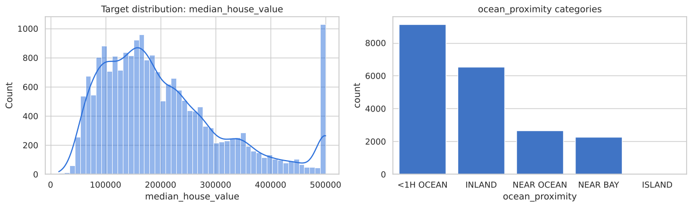
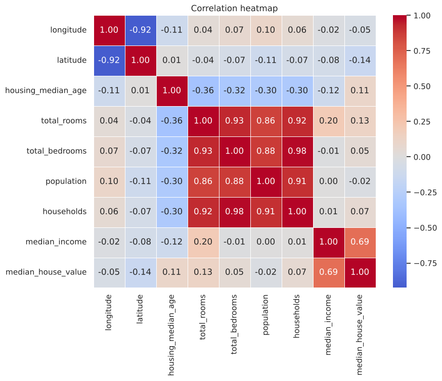
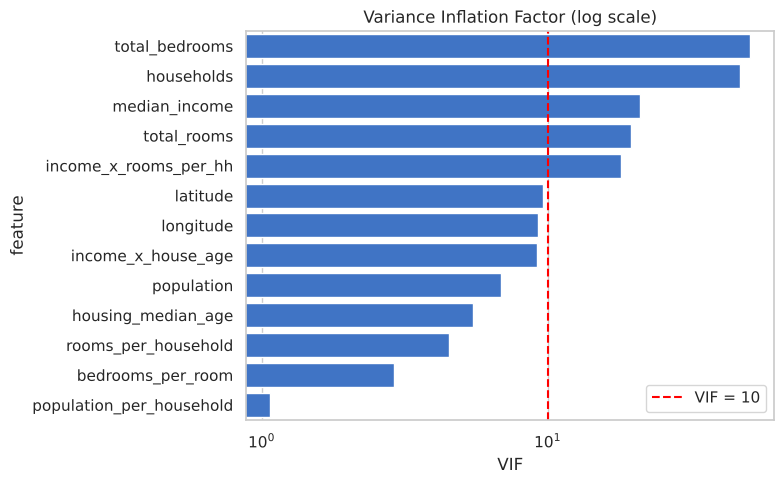
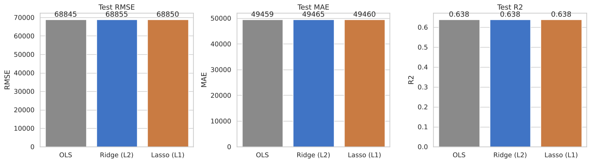
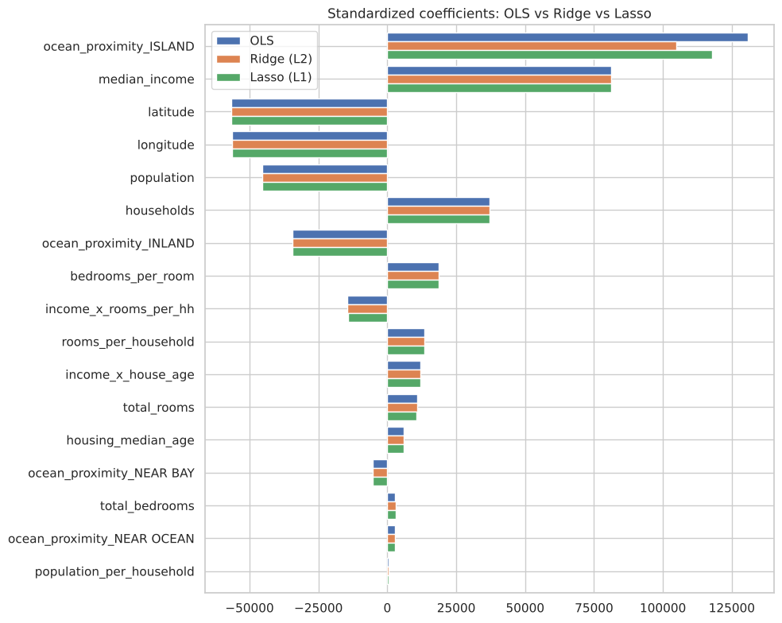
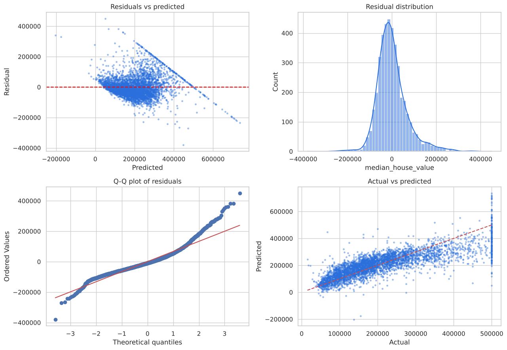

# Task 2: Housing Price Prediction (OLS, Ridge & Lasso)

Predicts median house value on the California Housing dataset (20,640 districts) and compares OLS, Ridge (L2) and Lasso (L1) regression.

## Approach
1. Explored the data (nulls, target distribution, correlation heatmap)
2. Imputed the 207 missing `total_bedrooms` values (median)
3. Engineered ratio and interaction features (`rooms_per_household`, `bedrooms_per_room`, `population_per_household`, `income_x_rooms_per_hh`, `income_x_house_age`)
4. Checked multicollinearity with VIF
5. Standardized numeric features, one-hot encoded `ocean_proximity` (single sklearn Pipeline, 80/20 split)
6. Tuned Ridge and Lasso `alpha` with 5-fold `GridSearchCV`
7. Residual error analysis

## Results (test set)
| Model | RMSE | MAE | R² |
|---|---|---|---|
| OLS | 68,845 | 49,459 | 0.638 |
| Ridge (L2), alpha = 1 | 68,855 | 49,465 | 0.638 |
| Lasso (L1), alpha ≈ 3.16 | 68,850 | 49,460 | 0.638 |

## Key findings
- All three models perform almost identically. With ~16k training rows and ~14 features there is little overfitting (train R² ≈ test R²), so regularization has little to fix.
- VIF showed strong multicollinearity (`latitude`, `longitude`, `total_bedrooms`, `households`, `total_rooms`, `median_income`). A `latitude × longitude` interaction was tried and dropped (VIF > 10,000).
- Residuals are centred near zero but spread out for expensive houses (heteroscedasticity), and prices capped at 500,001 create a visible band in the actual-vs-predicted plot.
- Linear models cap out near R² 0.64 here; non-linear models (Random Forest / Gradient Boosting) are the natural next step.

## Charts
| | |
|---|---|
|  |  |
|  |  |
|  |  |

## Run
```bash
pip install -r ../requirements.txt
jupyter notebook task2_housing_price_prediction.ipynb
```
