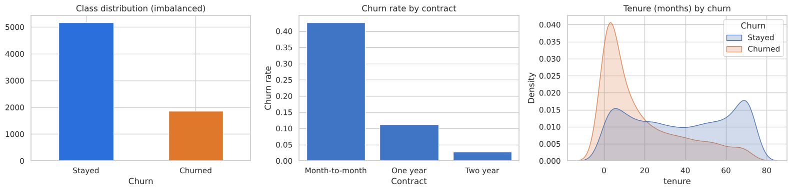
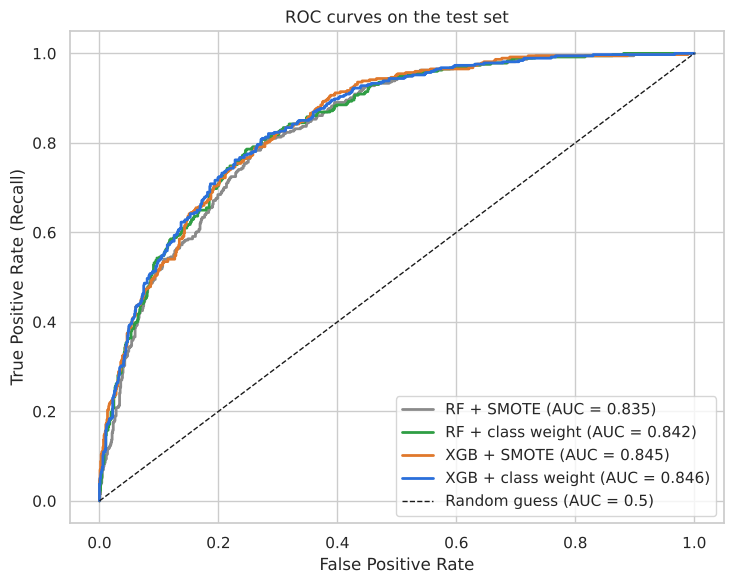
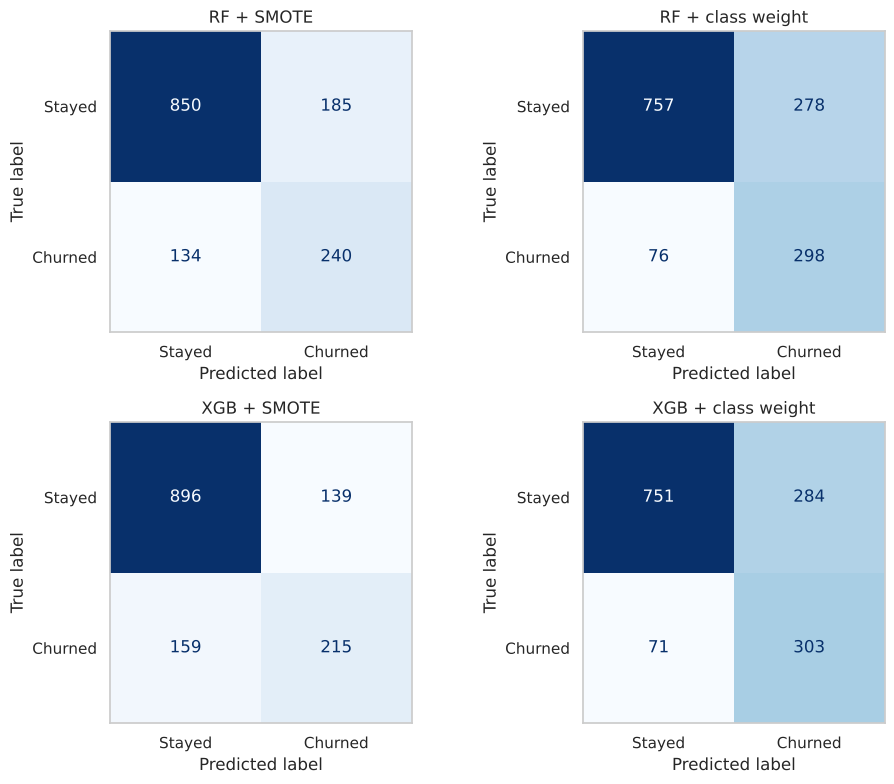
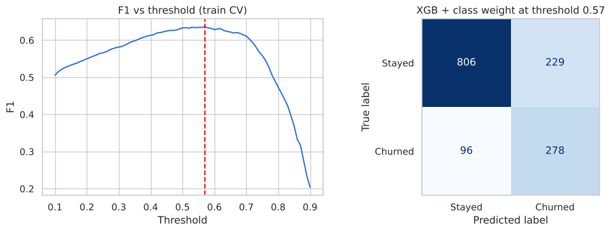
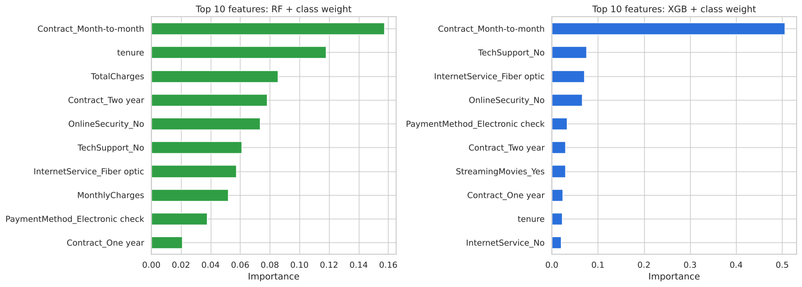

# Task 3: Customer Churn Prediction (Random Forest & XGBoost)

Predicts telecom customer churn on the Telco Customer Churn dataset (7,043 customers, 26.5% churn) and optimises ROC-AUC while handling the class imbalance.

## Approach
1. Cleaned data: `TotalCharges` converted to numeric (11 blank rows = brand-new customers, filled with 0), dropped `customerID`
2. `OneHotEncoder` for 15 categorical features inside a Pipeline (80/20 stratified split, no test leakage)
3. Class imbalance handled two ways: **SMOTE** (inside each CV fold only, via `imblearn` Pipeline) and **class weighting** (`class_weight="balanced"` / `scale_pos_weight`)
4. Random Forest and XGBoost tuned with `GridSearchCV` (5-fold stratified CV, scoring = ROC-AUC)
5. Evaluation: ROC curves, confusion matrices, precision / recall / F1, threshold analysis, top-10 feature importances

## Results (test set)
| Model | CV ROC-AUC | Test ROC-AUC | Precision | Recall | F1 |
|---|---|---|---|---|---|
| RF + SMOTE | 0.842 | 0.835 | 0.565 | 0.642 | 0.601 |
| RF + class weight | 0.848 | 0.842 | 0.517 | 0.797 | 0.627 |
| XGB + SMOTE | 0.848 | 0.846 | 0.607 | 0.575 | 0.591 |
| **XGB + class weight** | **0.848** | **0.846** | 0.516 | 0.810 | **0.631** |

All setups clear the ROC-AUC > 0.80 target.

## Key findings
- Month-to-month contract is the strongest churn driver, followed by short tenure, fiber optic internet, no tech support / online security, and electronic check payment.
- SMOTE and class weighting give almost the same AUC; class weighting catches more churners (recall about 0.8), which suits a retention use case.
- Threshold tuning (chosen on training CV only) trades recall for precision at the same F1.

## Charts
| | |
|---|---|
|  |  |
|  |  |
|  | |

## Run
```bash
pip install -r ../requirements.txt
jupyter notebook task3_customer_churn.ipynb
```
`telco.csv` must be in the same folder (the notebook falls back to a GitHub URL if missing).
